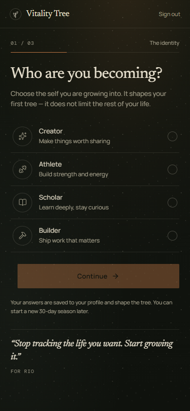
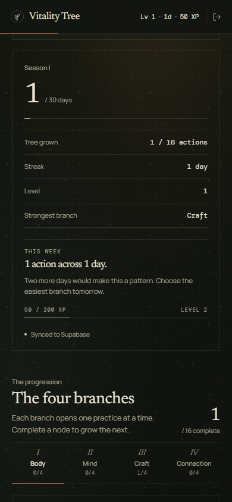
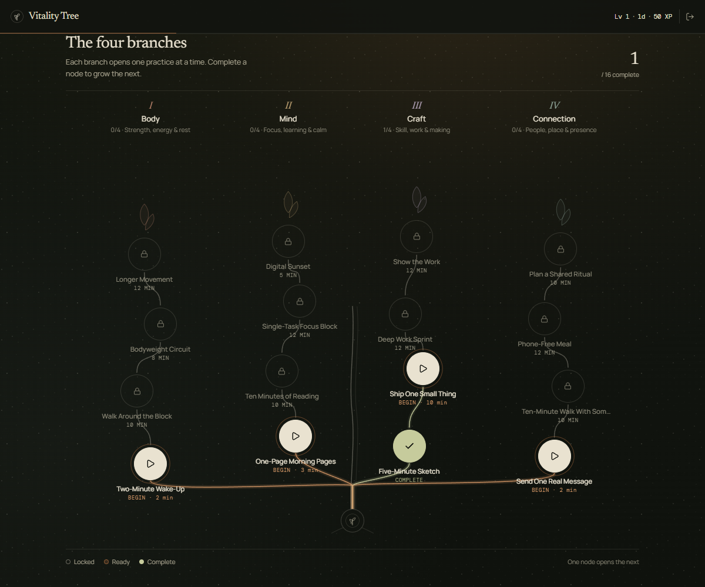

# Vitality Tree

**Stop tracking the life you want. Start growing it.**

A visual self-improvement game for young adults. You choose who you are
becoming, name one 30-day goal and what usually trips you up, review your
**Starting Seed Plan**, and grow a tree from the actions you actually take.
Body, mind, craft and connection each become a branch; every completed practice
opens the next one.

Built with **Expo (SDK 57)**, React Native, TypeScript, and Supabase (Auth,
Postgres, and Edge Functions). It runs in **Expo Go** on iOS and Android, and in
the browser through React Native Web.

The visual language is a nocturnal field journal — Newsreader + Manrope + DM
Mono, warm parchment on olive charcoal, copper for action, lichen for
completion. No neon, no glassmorphism, no emoji.

| Who you become | Your tree today | The next action | Weekly review |
| --- | --- | --- | --- |
|  |  |  |  |



---

## How the Personalized Starting Seed Plan Works

1. **Identity + Goal + Blocker Intake (Steps 1–3)**
   - Choose an identity (`Creator`, `Athlete`, `Scholar`, `Builder`).
   - Pick or write a 30-day goal and select what usually stops you (*Restarting every Monday*, *Phone & scroll loops*, *Not knowing what's next*, or *Low energy at day's end*).
   - Pick a honest daily time cap (`5`, `15`, or `30` minutes).
2. **Safety & Counter-Goal Guardrails (`src/lib/safety.ts`)**
   - Before generating a plan, `assessGoalSafety()` blocks harmful, extreme-restriction, sleep-deprivation, substance/gambling, or self-punishing goals and offers a 1-tap safe reframe.
   - Every generated node is scrubbed by `sanitizeGeneratedNode()` so no practice can prescribe unsafe behavior or exceed your daily time budget (Tier I Seeds are capped at 1–3 minutes).
3. **Starting Seed Plan Preview (Step 4)**
   - Before planting the tree to Supabase, Step 4 displays the personalized 30-day summary, active safety note, and all four Tier I Starting Seeds (`Body`, `Mind`, `Craft`, `Connection`) with a 1-tap **"Shrink all branches to a 5-minute daily cap"** button if the plan feels too heavy.
4. **Low-Energy 2-Minute Seed Downscaler (`NodeModal.tsx`)**
   - Inside any practice modal, tapping **"Low energy? 2-min seed"** shrinks a longer practice into a 2-minute seed version so you never break your rhythm or push into burnout.

---

## API Key Security (Zero Client Secret Exposure)

**No AI API key is ever placed in `.env` with `EXPO_PUBLIC_` or shipped inside the mobile/web bundle.**

- The mobile/web app calls `supabase.functions.invoke("generate-tree")` in [`src/lib/gemini.ts`](src/lib/gemini.ts).
- The Gemini API key lives exclusively in Supabase Edge Function secrets (`GEMINI_API_KEY`), consumed by [`supabase/functions/generate-tree/index.ts`](supabase/functions/generate-tree/index.ts).
- **MVP Starting Seed Engine works out of the box:** If you haven't deployed the Edge Function yet, `generateTree()` automatically uses the built-in goal-and-blocker-tailored **Starting Seed Engine** (`buildSeedPlan`), which adapts branches, titles, durations, and anti-friction steps to your exact goal and blocker with zero external key required.

To enable live Gemini generation on the server later:

```bash
npx supabase secrets set GEMINI_API_KEY=your_gemini_key_here
npx supabase functions deploy generate-tree
```

---

## Run it

```bash
npm install
cp .env.example .env            # fill in the two public Supabase values below
npx expo start
```

**Supabase is required.** Profiles, trees and practice history are stored only
in your Supabase project. The phone keeps just the signed-in session, so you are
signed back in automatically.

## What to put in `.env`

| Variable | Where to find it | Required |
| --- | --- | --- |
| `EXPO_PUBLIC_SUPABASE_URL` | Supabase → your project → **Connect** → Project URL | Required |
| `EXPO_PUBLIC_SUPABASE_PUBLISHABLE_KEY` | Supabase → **Connect** → Publishable key (`sb_publishable_...`) | Required |

Example:

```dotenv
EXPO_PUBLIC_SUPABASE_URL=https://abcdefghijklm.supabase.co
EXPO_PUBLIC_SUPABASE_PUBLISHABLE_KEY=sb_publishable_xxxxxxxxxxxxxxxxxxxx
```

Never put a Supabase **secret** key (`sb_secret_...`), `service_role` key, or
`GEMINI_API_KEY` in `.env` or any `EXPO_PUBLIC_` variable.

## Supabase setup

A fresh project can start from [`supabase/schema.sql`](supabase/schema.sql). An existing
project must **not** re-run it (it contains destructive legacy cleanup): apply the files in
[`supabase/migrations/`](supabase/migrations) in order instead, after a backup.

1. Review each migration and its rollback note.
2. Apply them in the SQL editor, newest last.
3. Verify the tables and columns are live with:

   ```bash
   npm run db:check
   ```

Nothing in this repository has been applied to the live project. The exact remaining
database, function and auth steps are in [docs/RELEASE_CHECKLIST.md](docs/RELEASE_CHECKLIST.md).

## Scripts

```bash
npx expo start        # Expo dev server (QR code, Expo Go, web)
npm run android       # open on an Android device/emulator
npm run ios           # open on an iOS simulator (macOS)
npm run web           # run in the browser
npm run typecheck     # TypeScript, no emit
npm run lint          # ESLint; must stay at zero problems
npm test              # unit + embedded-Postgres migration tests
npm run safety:sync   # copy the canonical safety rules into the Edge Function
npm run safety:check  # fail if that copy has drifted
npm run test:rls      # live two-account isolation check (needs test accounts)
npm run db:check      # verify the Supabase tables and columns exist
```

CI runs install, `safety:check`, typecheck, lint and tests on every push
([.github/workflows/ci.yml](.github/workflows/ci.yml)).

## Version control and backups

The source repository is [zrewt/Progress](https://github.com/zrewt/Progress).
Commit small, reviewed changes so each milestone has a recoverable checkpoint.

- `.env` and other live environment files, `.freebuff/`, `.backups/`, dependencies,
  generated builds, and diagnostic screenshots stay out of Git. Only the five
  reviewed demo screenshots used above are included.
- `.env.example` contains placeholders only. Keep real credentials in your local
  `.env` and in the relevant server-side secret store; never commit them.
- A verified pre-Git source ZIP and checksum are stored locally in `.backups/`.
  This archive excludes credentials, screenshots and generated files. Copy it to
  a separate private drive/location for protection against losing this computer.
- Source backups do **not** back up the live Supabase database, Auth users or Edge
  Function secrets. Those require separate provider-side recovery procedures.

The lint bootstrap added only the `lint` script, development dependencies
`eslint` and `eslint-config-expo`, their lockfile entries, and `eslint.config.js`.
They are retained as diagnostic tooling, not as a claim that lint currently
passes. See [the readiness audit](APP_STORE_READINESS.md) for known findings.

## Structure

```
App.tsx                                      # fonts, providers, auth/onboarding/dashboard switch
src/
  theme.ts                                   # palette, type stack, shared tokens
  lib/
    types.ts                                 # app types (identities, blockers, branches, profile)
    pillars.ts                               # identities, blockers, goals, branches and time options
    safety-rules.ts                          # canonical safety rules shared with the Edge Function
    safety.ts                                # client wrappers, PII scrubbing, node sanitizer
    plans/                                   # 10 curated goal themes, variants, alternatives
    progression.ts                           # XP, milestone days, local dates and streaks
    today.ts                                 # today's practice, gaps, history, review timing
    review.ts                                # deterministic weekly-review rules
    offline-queue.ts                         # durable queue logic; offline-store.ts persists it
    daily-data.ts                            # Supabase reads and owner-scoped RPC calls
    config.ts                                # consent copy/version, support + privacy placeholders
    tree.ts                                  # levels, tree presentation helpers
    supabase.ts                              # lazy client + AsyncStorage session
    game-context.tsx                         # auth, cloud persistence, XP/streak state
    gemini.ts                                # Edge Function client + Starting Seed Plan engine
  components/
    SetupRequired.tsx                        # shown when Supabase credentials are missing
    AuthScreen.tsx                           # editorial auth
    Onboarding.tsx                           # 4-step intake + safety check + Starting Seed Plan preview
    Dashboard.tsx                            # future-self header, next action, season, weekly review
    SkillTree.tsx                            # branching SVG tree + mobile branch view
    NodeModal.tsx                            # practice sheet + goal tie-in + 2-min seed toggle
supabase/
  schema.sql                                 # tables + RLS + migration
  functions/generate-tree/index.ts           # server-side Gemini Edge Function (keeps API key hidden)
scripts/check-supabase.mjs                   # npm run db:check
```

Vitality Tree is a habit and self-improvement tool, not medical advice.
